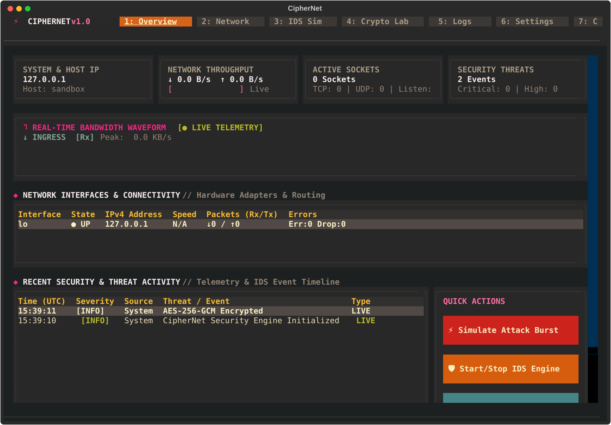
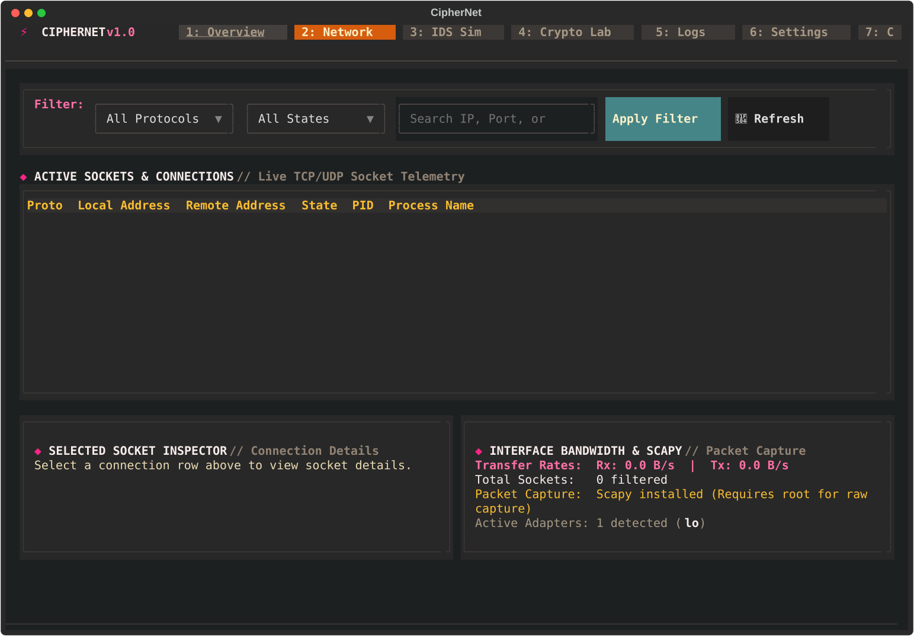
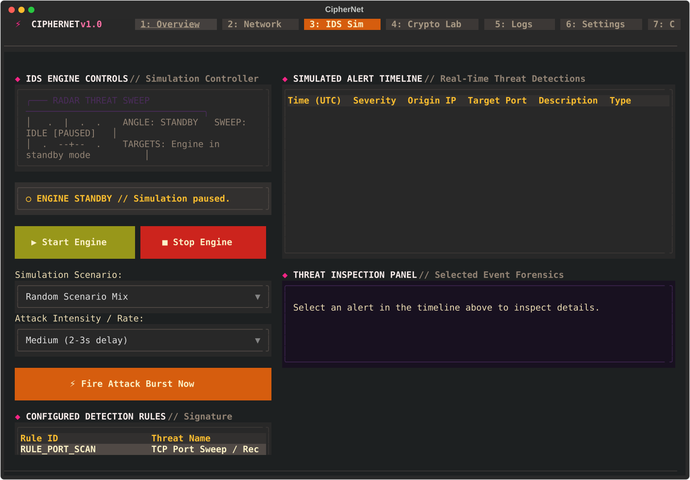
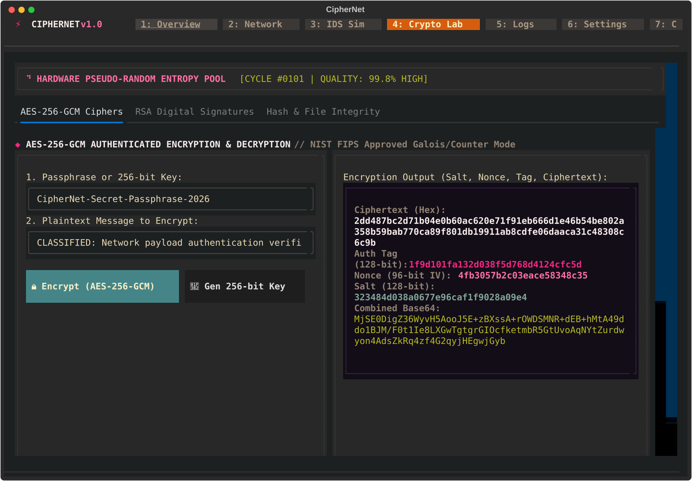
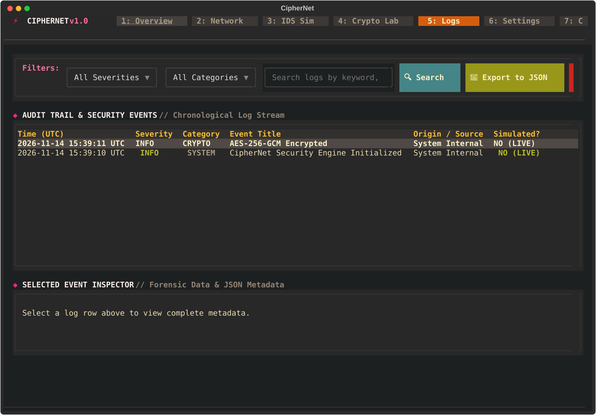
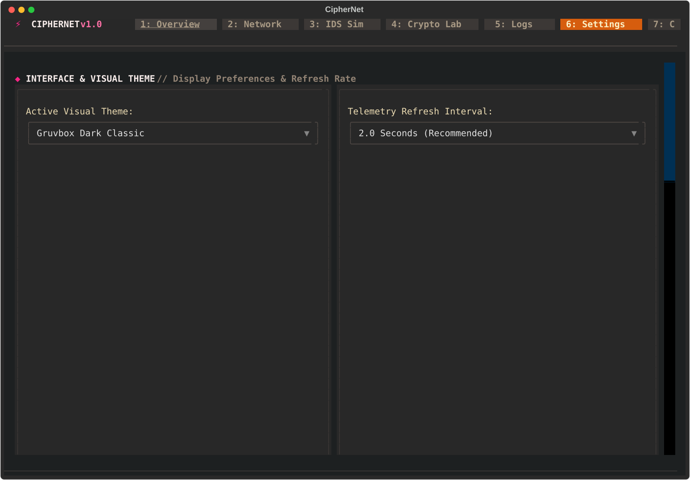
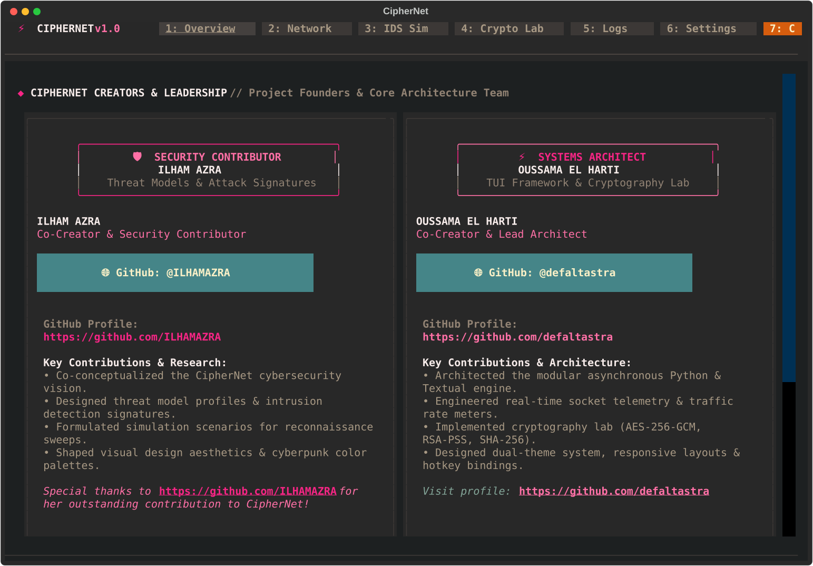

<div align="center">

# ⚡ CipherNet
### Next-Generation Network Security & Cryptographic Telemetry Dashboard

[](https://python.org)
[](https://www.qt.io/qt-for-python)
[](https://pyqtgraph.readthedocs.io)
[](https://github.com)
[](https://opensource.org/licenses/MIT)
[](tests/test_app.py)

<p align="center">
  <b>A modern, standalone desktop cybersecurity operations dashboard built with PySide6. Designed for security analysts, network engineers, and cryptography researchers.</b>
</p>

[Key Features](#-key-features) •
[Interface Tour](#-interface-tour) •
[Architecture](#-architecture) •
[Installation & Usage](#-installation--usage) •
[Keyboard Shortcuts](#-keyboard-shortcuts) •
[Testing](#-testing) •
[Special Thanks & Creators](#-special-thanks--creators) •
[License](#-license)

---

</div>

<p align="center">
  
</p>

---

## 🌟 Overview

**CipherNet** is an all-in-one desktop security workstation built with **PySide6 (Qt for Python)**. It pairs real-time system socket inspection and dynamic anti-aliased bandwidth charting with an interactive intrusion detection simulation engine, authenticated cryptography lab, and forensic audit logging.

Engineered with an ergonomic dark charcoal & cyber-rose aesthetic, asynchronous background worker threads, and sub-millisecond local telemetry processing, CipherNet delivers a completely fluid, non-blocking user experience.

---

## ✨ Key Features

<table>
<tr>
<td width="50%" valign="top">

### 📊 Real-Time Telemetry & Traffic Charting
- **Dynamic PyQtGraph Curves**: Smooth 60 FPS plotting of incoming (Rx) and outgoing (Tx) network bandwidth.
- **Hardware Interface Inspector**: Live adapter status (`UP`/`DOWN`), MTU values, link speeds, drop counts, and error counters.
- **Telemetry Metric Cards**: Primary IPv4 address, host identification, active socket counters, and real-time threat scores.

</td>
<td width="50%" valign="top">

### 🔍 Deep Network Socket Forensics
- **Live Connection Tracking**: Inspect all active TCP & UDP endpoints with associated PID and process names.
- **Instant Facet Filtering**: Filter sockets by state (`LISTEN`, `ESTABLISHED`, `TIME_WAIT`) or protocol.
- **Search & Endpoint Inspector**: Instant search by IP, port, or executable, with detailed connection diagnostics.

</td>
</tr>
<tr>
<td width="50%" valign="top">

### 📡 Intrusion Detection Simulator (IDS)
- **360° Cyber Radar Sweep**: Real-time canvas rendering rotating radar sweep lines, blips, and threat severity gauges.
- **Rule Signature Engine**: Pre-loaded signatures for SYN flood patterns, port sweeps, C2 reverse shells, and DNS exfiltration.
- **Scenario Generator**: Multi-tier synthetic attack generator (`Low`, `Medium`, `Aggressive`) with explicit `[SIMULATED]` safety tags.

</td>
<td width="50%" valign="top">

### 🔐 Cryptography & Entropy Lab
- **AES-256-GCM Sandbox**: Authenticated encryption/decryption with PBKDF2 key derivation and 128-bit MAC tamper detection.
- **RSA-PSS Signatures**: Background generation of 2048-bit & 4096-bit keypairs with PEM export and digital signature validation.
- **Entropy Streamer**: Live visualizer of operating system hardware entropy pools.
- **Multi-Digest Hashing**: Instant hashing with SHA-256, SHA-512, SHA3-256, and BLAKE2b + file integrity verifier.

</td>
</tr>
</table>

---

## 🖥️ Interface Tour

CipherNet organizes security workflows into distinct dedicated modules:

<details open>
<summary><b>1. Overview Dashboard</b></summary>
<p align="center">
  
</p>
Telemetry metrics, real-time bandwidth graph, hardware adapter statuses, and live security event stream.
</details>

<details>
<summary><b>2. Network Socket Monitor</b></summary>
<p align="center">
  
</p>
Real-time TCP/UDP socket table, protocol/state filter buttons, live search, and connection forensic inspector.
</details>

<details>
<summary><b>3. Intrusion Detection Simulator (IDS)</b></summary>
<p align="center">
  
</p>
Rotating 360° radar sweep visualization, signature engine rules table, and chronological incident timeline.
</details>

<details>
<summary><b>4. Cryptography Lab</b></summary>
<p align="center">
  
</p>
Streaming hardware entropy visualizer, AES-256-GCM encryption/decryption, RSA keypair generation, and file hash checker.
</details>

<details>
<summary><b>5. Security Logs & Forensic Ledger</b></summary>
<p align="center">
  
</p>
Immutable event ledger with severity tags, category filters, detailed log inspector, and JSON export capability.
</details>

<details>
<summary><b>6. Settings & Preferences</b></summary>
<p align="center">
  
</p>
Theme engine (Dark Charcoal & Rose, Cyber Neon Magenta, Gruvbox Dark), telemetry poll intervals, and network switches.
</details>

<details>
<summary><b>7. Creators & Research Profiles</b></summary>
<p align="center">
  
</p>
Dedicated interactive profiles honoring project creators, threat modeling research, and architectural contributions.
</details>

---

## 🏗️ Architecture

```
CipherNet/
├── ciphernet/
│   ├── app.py                   # Main PySide6 MainWindow application shell
│   ├── workers.py               # Asynchronous QThread workers (RSA, Socket scan, Entropy)
│   ├── styles.tcss              # Custom cyber styling and theme palettes
│   ├── config/
│   │   └── settings.json        # Persistent user preferences
│   ├── modules/                 # Modular dashboard views
│   │   ├── overview.py          # Real-time dashboard & traffic chart
│   │   ├── network.py           # Socket monitor & forensic inspector
│   │   ├── ids.py               # Intrusion detection radar & rules engine
│   │   ├── cryptography.py      # AES-GCM, RSA-PSS, entropy, and file hashing
│   │   ├── logs.py              # Security audit log table & JSON exporter
│   │   ├── settings.py          # Application configuration view
│   │   └── creators.py          # Creator showcase & attribution cards
│   ├── services/                # Decoupled backend domain services
│   │   ├── network_service.py   # psutil socket extraction & interface stats
│   │   ├── crypto_service.py    # Python cryptography engine (AES, RSA, Hashes)
│   │   ├── detection_service.py # Rule-based threat engine & attack simulation
│   │   ├── event_service.py     # Event dispatching, ring buffer, & metrics
│   │   └── settings_service.py  # Configuration persistence & theme switching
│   └── widgets/                 # Reusable custom UI components
│       ├── radar_widget.py      # Animated cyber radar sweep canvas
│       ├── traffic_chart.py     # Hardware-accelerated PyQtGraph bandwidth chart
│       └── navigation.py        # Sidebar navigation controller
├── assets/                      # Media assets & SVG interface previews
├── tests/
│   └── test_app.py              # Comprehensive automated PySide6 test suite
├── main.py                      # Application entry point
├── run.sh                       # Quick launch wrapper script
└── requirements.txt             # Python dependencies
```

---

## 🚀 Installation & Usage

### Prerequisites
- **Python 3.10+**
- Linux (X11 / Wayland), macOS, or Windows

### 1. Clone & Set Up Environment

```bash
# Clone the repository
git clone https://github.com/defaltastra/CipherNet.git
cd CipherNet

# Create a virtual environment
python3 -m venv .venv
source .venv/bin/activate  # On Windows: .venv\Scripts\activate

# Install required dependencies
pip install -r requirements.txt
```

### 2. Launch the Application

```bash
# Using the launcher script:
./run.sh

# Or directly with Python:
python3 main.py
```

### 3. CLI Helper Options

```bash
# Verify environment and PySide6 graphical setup:
python3 main.py --check-env

# Display version:
python3 main.py --version

# Use a custom settings path:
python3 main.py --config /path/to/custom_settings.json
```

---

## ⌨️ Keyboard Shortcuts

CipherNet is designed for rapid keyboard-driven navigation:

| Key Binding | Module / Action |
|:---:|:---|
| <kbd>1</kbd> | Switch to **Overview Dashboard** |
| <kbd>2</kbd> | Switch to **Network Monitor** |
| <kbd>3</kbd> | Switch to **Intrusion Detection Simulator** |
| <kbd>4</kbd> | Switch to **Cryptography Lab** |
| <kbd>5</kbd> | Switch to **Security Logs & Ledger** |
| <kbd>6</kbd> | Switch to **Settings & Preferences** |
| <kbd>7</kbd> | Switch to **Creators & Research Attribution** |
| <kbd>S</kbd> | Start / Stop **IDS Simulation Engine** |
| <kbd>R</kbd> | Force refresh active telemetry view |
| <kbd>?</kbd> or <kbd>F1</kbd> | Open interactive Keyboard Shortcuts Modal |
| <kbd>Ctrl</kbd> + <kbd>Q</kbd> | Safely quit CipherNet |

---

## 🧪 Testing

CipherNet features a test suite validating service integrity, cryptography, and headless GUI mounting (via `QT_QPA_PLATFORM=offscreen`):

```bash
# Run the automated test suite
.venv/bin/python -m unittest tests/test_app.py
```

```text
Ran 15 tests in ~40s
OK
```

---

## 💖 Special Thanks & Creators

CipherNet was conceptualized and developed through collaborative engineering in security architecture and threat research.

<div align="center">

| <br>**Ilham Azra**<br>[@ILHAMAZRA](https://github.com/ILHAMAZRA) | <br>**Oussama El Harti**<br>[@defaltastra](https://github.com/defaltastra) |
|:---:|:---:|
| 🛡️ **Security Contributor & Threat Research** | ⚡ **Systems Architect & Lead Developer** |
| Co-conceptualization & Cyber Vision<br>Threat Models & Attack Signature Design<br>Simulation Scenarios for Reconnaissance Sweeps<br>Visual Aesthetics & Cyberpunk Color Direction | Standalone PySide6 Framework & UI Architecture<br>Asynchronous Background Workers (`QThread`)<br>Real-Time Socket Telemetry & PyQtGraph Meters<br>Cryptography Lab (AES-256-GCM, RSA-PSS) |

</div>


---

## 📄 License

This project is licensed under the **[MIT License](https://opensource.org/licenses/MIT)** — feel free to use, modify, and distribute it for personal, research, or commercial projects.

<div align="center">
<sub>Crafted with passion for cybersecurity researchers and open source communities.</sub>
</div>